## Task 6 — Reading the Plan

* **Pre-Run Expectation:** Expected a scan/seek on `Invoices` for overdue unpaid rows, a lookup on `StudentProfiles`, a join, `Compute Scalar` for `Remaining` and `Urgency`, a `Top N Sort` for `TOP (15)` ordered by `Remaining DESC`, and final `SELECT`.
* **Key Plan Differences:**
  * Used an **Adaptive Join** that picked **Hash Match** at runtime because row count crossed the `6736.59` threshold.
  * Showed two `StudentProfiles` branches: a non-clustered index scan ran (`304,953` rows), while the alternative clustered index seek for `Nested Loops` had `0` executions.
  * Underestimated `Invoices` output (`204,678` estimated vs. `399,504` actual rows).
  * Ran with parallelism (`DOP = 12`) and **Batch Mode on RowStore**, gathering streams before `Top`.
* **IO, Time & Memory:**
  * `Elapsed time = 359 ms`, `CPU time = 60 ms`, `Compile time = 21 ms`, `Memory Grant = 145 MB`.
  * Logical reads: `11,007` (`Invoices`) and `2,343` (`StudentProfiles`), with `Worktable = 0` (no tempdb sort spill) and `15` rows returned.

### Screenshots
* 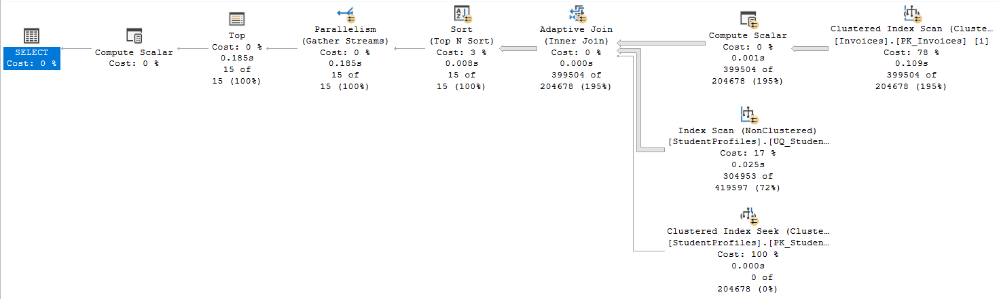
* 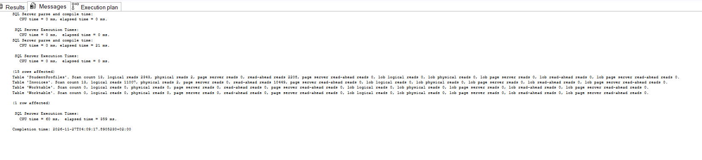
* 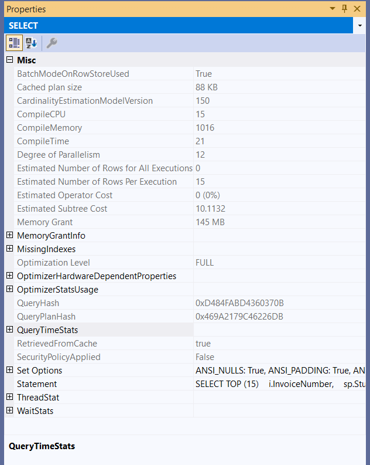
* 
* 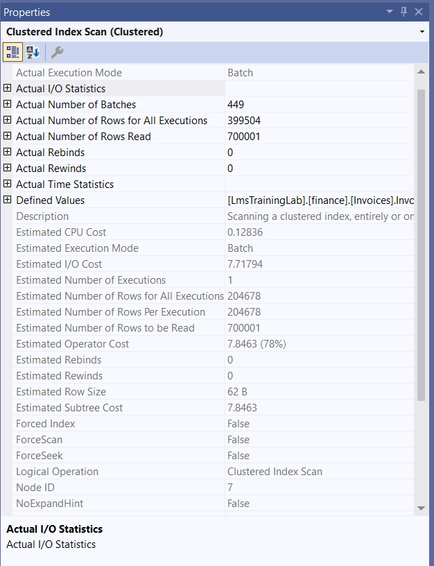
* 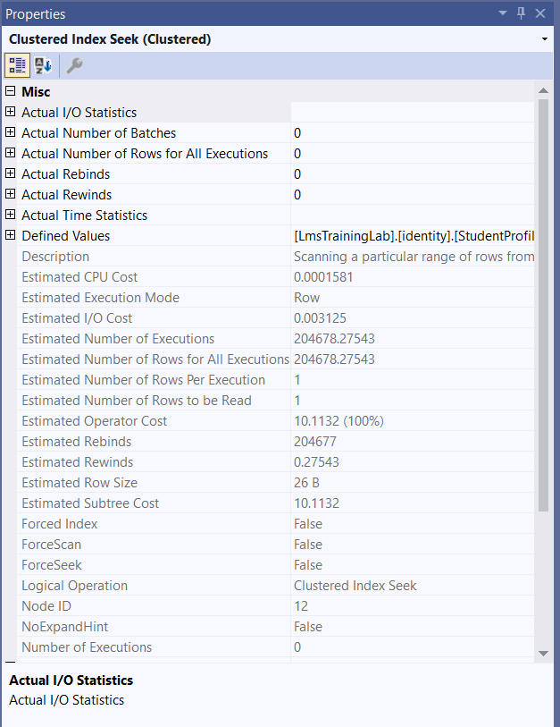
* 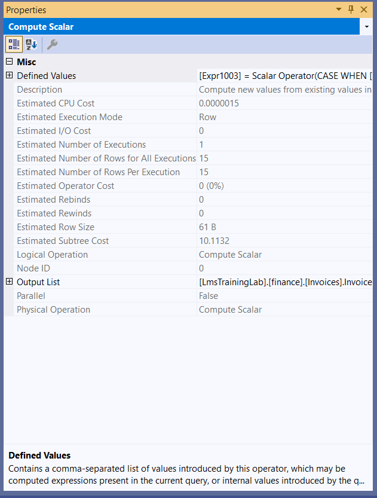
* 
* 
* 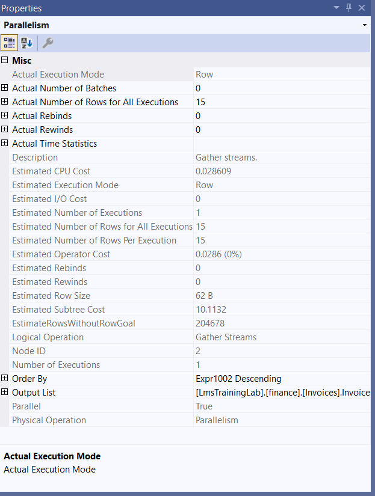
* 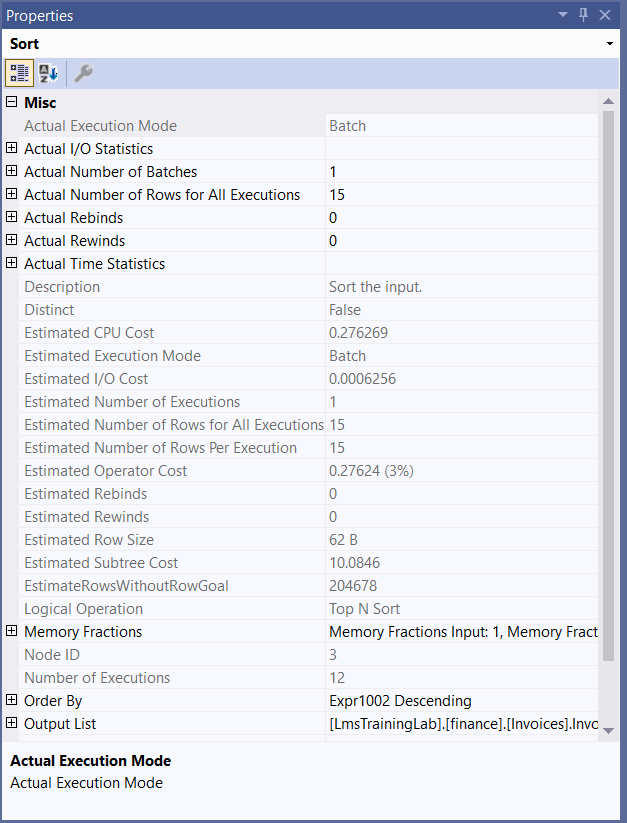
* 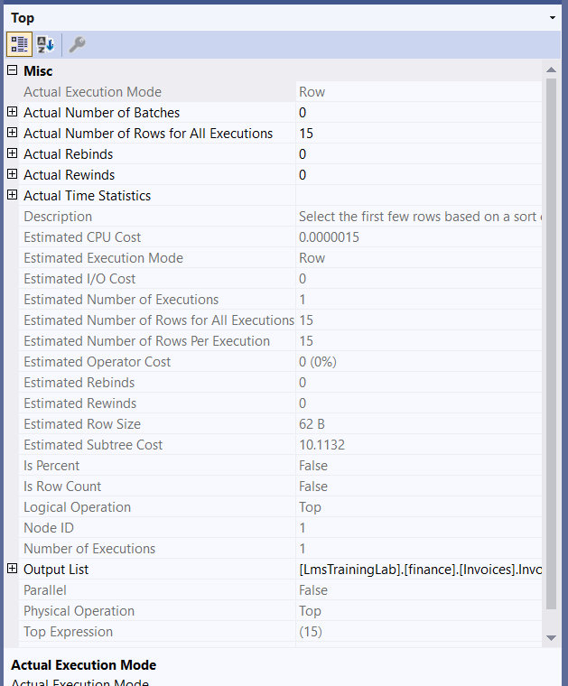[cite: 1]

## Task 7 — Make It Faster

### Summary of Logical Reads (Before vs. After)

| Query | Problem | Logical Reads (Before) | Logical Reads (After) | Improvement |
| :--- | :--- | :---: | :---: | :---: |
| **7.1** | Non-SARGable `YEAR()` & `MONTH()` on `CreatedAtUtc` | 4,637 | 78 | **98.3% reduction** |
| **7.2** | Non-SARGable `DATEDIFF()` on `PaidAtUtc` | 1,879 | 123 | **93.5% reduction** |
| **7.3** | Non-SARGable `LEFT()` on `LastName` | 5,694 | 204 | **96.4% reduction** |
| **7.4** | Arithmetic expression (`Id + 1`) on `Id` | 129,900 | 4 | **99.99% reduction** |
| **7.5** | Implicit conversion (`VARCHAR` column vs. `NVARCHAR` literal) | 3,452 | 6 | **99.8% reduction** |
| **7.6** | Redundant `UPPER()` on case-insensitive `Email` column | 4,637 | 3 | **99.9% reduction** |
| **7.7** | Catch-all `OR` (`@LastName IS NULL OR LastName = @LastName`) | 5,694 | 189 | **96.7% reduction** |
| **7.8** | Non-SARGable `COALESCE()` on `PaidAtUtc` | 1,879 | 146 | **92.2% reduction** |

---

### 7.1 — Users Who Registered in March 2026
* **Problem:** Wrapping `CreatedAtUtc` inside `YEAR()` and `MONTH()` makes the predicate non-SARGable, forcing an `Index Scan` across `IX_Users_CreatedAtUtc` instead of seeking directly to the March 2026 range.
* **Fix:** Replaced the function calls with a half-open date range (`>= '2026-03-01'` and `< '2026-04-01'`), enabling an `Index Seek`.
* **Logical Reads:** `4,637` (Before) $\rightarrow$ `78` (After) (Elapsed time: `4,787 ms` $\rightarrow$ `106 ms`).

**Before Plan:**
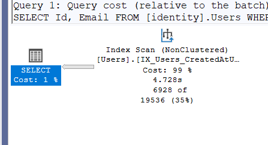

**After Plan:**
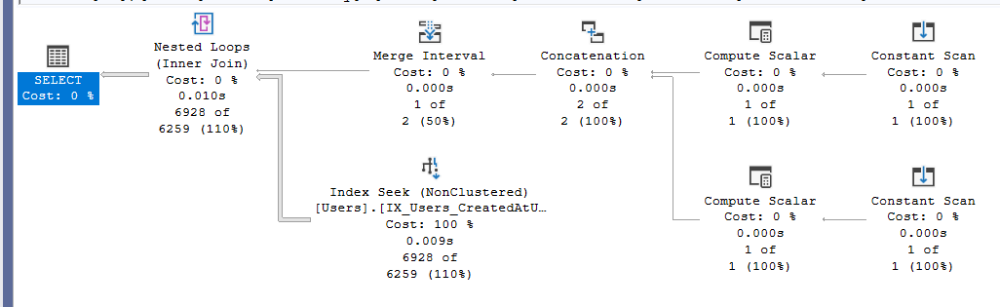

---

### 7.2 — Payments of the Last 30 Days
* **Problem:** Applying `DATEDIFF(DAY, PaidAtUtc, SYSUTCDATETIME())` to the indexed column prevents SQL Server from using `IX_Payments_PaidAtUtc` for a range seek, resulting in a full `Index Scan`.
* **Fix:** Moved the date calculation to the right-hand side (`PaidAtUtc >= DATEADD(DAY, -30, SYSUTCDATETIME())`) so the column stands alone and uses an `Index Seek`.
* **Logical Reads:** `1,879` (Before) $\rightarrow$ `123` (After) (Elapsed time: `220 ms` $\rightarrow$ `175 ms`).

**Before Plan:**
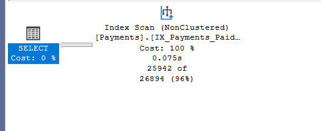

**After Plan:**
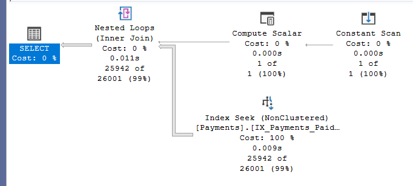

---

### 7.3 — Last Names Starting with `"Abd"`
* **Problem:** Using `LEFT(LastName, 3) = N'Abd'` applies a scalar function to every row in `LastName`, preventing a B-tree range seek on `IX_Users_LastName` and causing a full scan.
* **Fix:** Replaced `LEFT()` with a prefix `LIKE` pattern (`LastName LIKE N'Abd%'`), allowing an `Index Seek`.
* **Logical Reads:** `5,694` (Before) $\rightarrow$ `204` (After) (Elapsed time: `65,772 ms` $\rightarrow$ `114 ms`).

**Before Plan:**
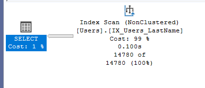

**After Plan:**
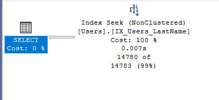

---

### 7.4 — Audit Log Lookup by `Id`
* **Problem:** Writing `WHERE Id + 1 = 50001` performs arithmetic on the primary key column, forcing a parallel `Clustered Index Scan` across the entire `operations.AuditLogs` table.
* **Fix:** Simplified the math beforehand (`WHERE Id = 50000`), turning the scan into a direct `Clustered Index Seek`.
* **Logical Reads:** `129,900` (Before) $\rightarrow$ `4` (After) (Elapsed time: `1,389 ms` $\rightarrow$ `1 ms`).

**Before Plan:**
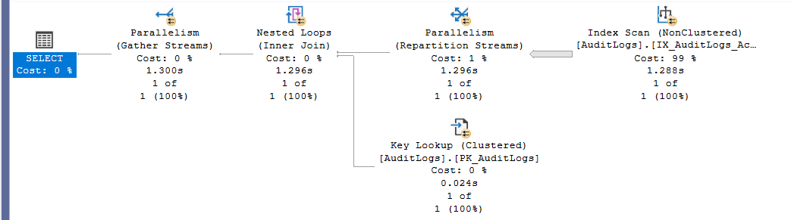

**After Plan:**
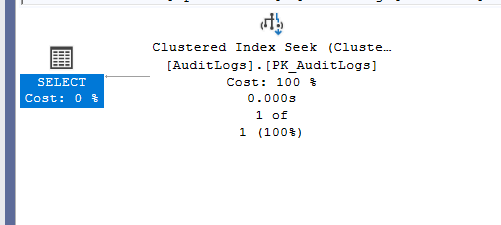

---

### 7.5 — Invoice Lookup by `InvoiceNumber`
* **Problem:** `InvoiceNumber` is stored as `VARCHAR`, while the literal `N'LAB-INV-2026-000001'` is `NVARCHAR`. Due to data-type precedence, SQL Server implicitly converts the column (`CONVERT_IMPLICIT`), preventing a seek on `IX_Invoices_Number` and triggering a `Clustered Index Scan` with a plan warning.
* **Fix:** Removed the `N` prefix (`WHERE InvoiceNumber = 'LAB-INV-2026-000001'`) so both sides match as `VARCHAR`, eliminating the implicit conversion and enabling an `Index Seek`.
* **Logical Reads:** `3,452` (Before) $\rightarrow$ `6` (After) (Elapsed time: `95 ms` $\rightarrow$ `39 ms`).

**Before Plan:**
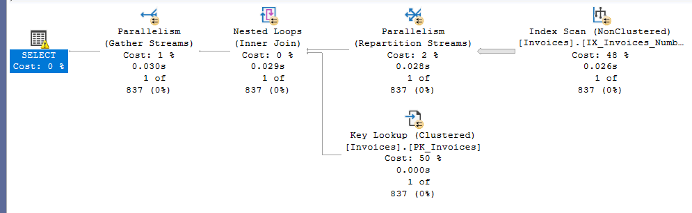

**After Plan:**
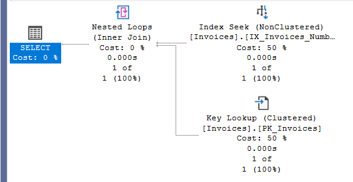

---

### 7.6 — Login Screen Email Lookup
* **Problem:** Wrapping `Email` in `UPPER(Email)` blocks an `Index Seek` on `IX_Users_Email` and forces an `Index Scan`, even though the database collation is already case-insensitive (`CI`).
* **Fix:** Removed `UPPER()` (`WHERE Email = @Email`), allowing a direct `Index Seek` on `IX_Users_Email`.
* **Logical Reads:** `4,637` (Before) $\rightarrow$ `3` (After) (Elapsed time: `132 ms` $\rightarrow$ `2 ms`).

**Before Plan:**
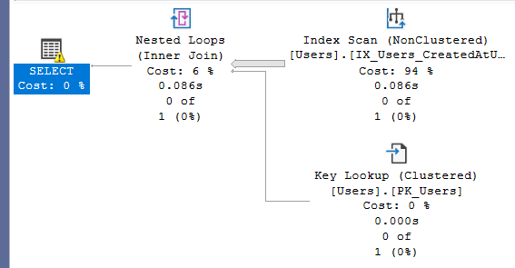

**After Plan:**
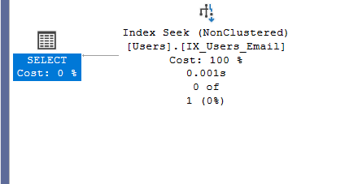

---

### 7.7 — Search Screen Optional `@LastName` Filter
* **Problem:** The catch-all condition `WHERE (@LastName IS NULL OR LastName = @LastName)` forces the optimizer to produce a single safe plan (an `Index Scan`) capable of handling `NULL` at runtime, even when a concrete value like `N'Hassan'` is supplied.
* **Fix:** Added `OPTION (RECOMPILE)` so SQL Server compiles a plan tailored to the actual runtime value of `@LastName` (`Index Seek` when provided, `Index Scan` only when `NULL`).
* **Logical Reads:** `5,694` (Before) $\rightarrow$ `189` (After) (Elapsed time: `259 ms` $\rightarrow$ `122 ms`).

**Before Plan:**
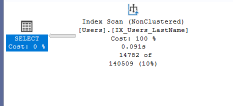

**After Plan:**
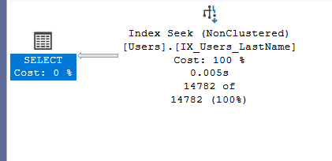

---

### 7.8 — Additional Non-SARGable `WHERE` Example (`COALESCE` on `PaidAtUtc`)
* **Problem:** Filtering with `WHERE COALESCE(PaidAtUtc, '1900-01-01') >= '2026-10-01T00:00:00'` wraps the indexed `PaidAtUtc` column in a function, forcing a full `Index Scan` on `IX_Payments_PaidAtUtc`.
* **Fix:** Removed `COALESCE()` (`WHERE PaidAtUtc >= '2026-10-01T00:00:00'`), since `NULL` values do not satisfy `>=` anyway, allowing an `Index Seek`.
* **Logical Reads:** `1,879` (Before) $\rightarrow$ `146` (After) (Elapsed time: `31,746 ms` $\rightarrow$ `236 ms`).

**Before Plan:**
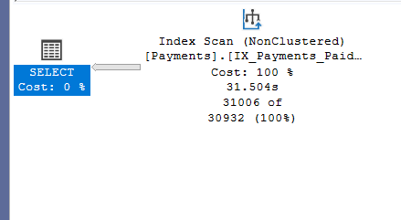

**After Plan:**
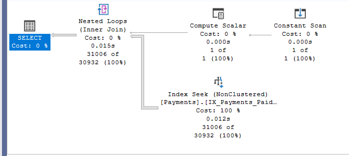

## Task 8 — TempDB Sort Spill

* **What happened:** The `Sort` operator ran out of memory during sorting and spilled temporary data to `tempdb`.
* **Why it happened:** Sorting a large table with a wide text column needed more memory than what was granted to the query.
* **What `Spill Level 1` means:** It is the first level of spilling to `tempdb` when the granted memory is not enough to finish sorting in memory.
* **Why it is slow:** Reading and writing data to `tempdb` on disk is much slower than keeping everything in memory (`RAM`).
* **The fix:** Sorted on a smaller column (`Id`) and recompiled so the query fits comfortably in memory without spilling.

**Before fix:**
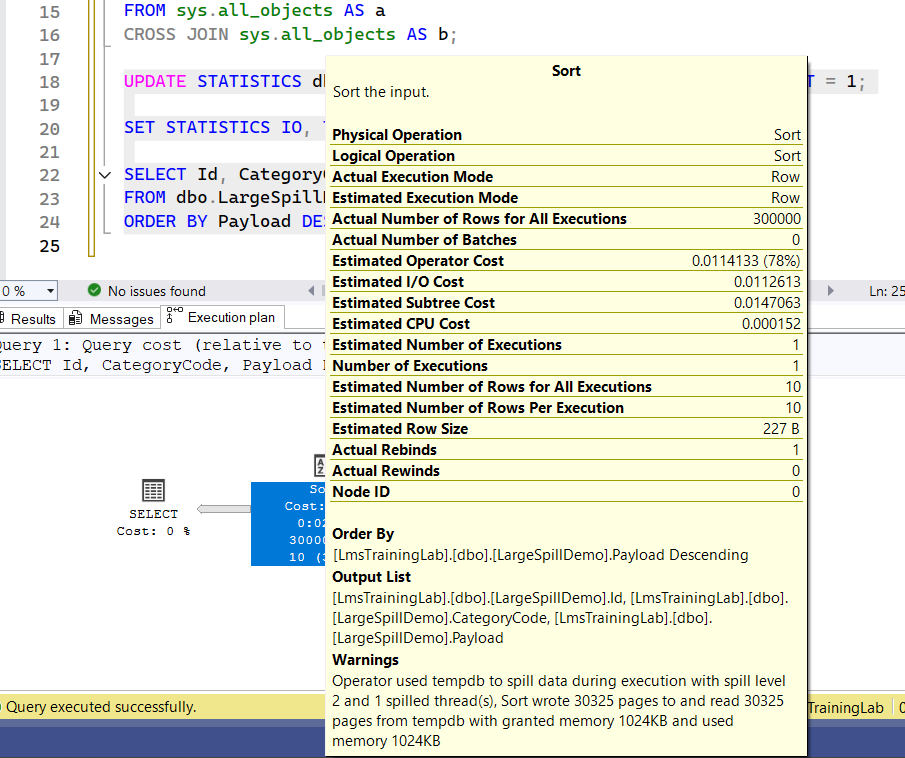

**After fix:**

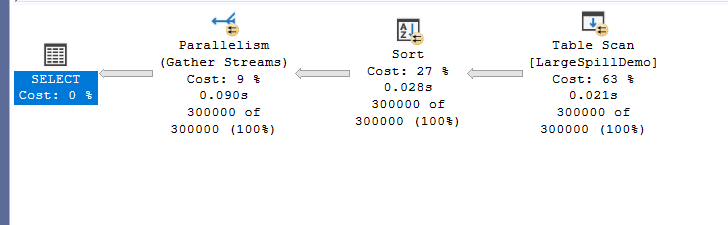

## Task 9 — One of Each

* **Unindexed column (`DISTINCT`):** SQL Server used `Hash Match (Aggregate)` because the data was not sorted and had no index. It builds a quick lookup structure in memory to remove duplicates.
* **Cheaper alternative (`Stream Aggregate`):** It goes through already-sorted data in one pass and compares each row with the previous one using very little memory. It needs the data to arrive sorted (for example, through a sorted index).
* **Unique values (`Id` without `UNIQUE` constraint):** Even though the values were unique in the table, SQL Server still checked and processed the rows with `Hash Match (Aggregate)` because there was no `UNIQUE` constraint guaranteeing uniqueness.
* **With `UNIQUE` constraint:** After adding a `UNIQUE` constraint on `Id`, SQL Server used an `Index Scan` without needing a `Hash Match (Aggregate)` to remove duplicates.

**Distinct UnIndexed:**

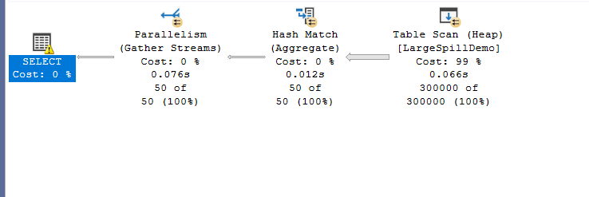

**distinct unique constraint:**

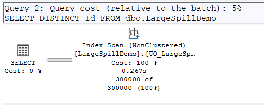

## Task 10 — The CTO's Question

* **When to use Numbers (`INT` / `BIGINT`):** Best for internal primary keys and indexes. They take less space, fit more data in memory, stay in order, and are faster for normal database queries.
* **When to use GUIDs (`UNIQUEIDENTIFIER`):** Best when IDs need to be created outside the database (like in distributed apps or offline clients), when merging data from multiple sources without ID clashes, or when you don't want sequential IDs to be easy to guess.
* **Practical choice:** Use `BIGINT` (or `INT` when safe) for fast internal keys and joins, and use `GUID`s when distributed generation, merging, or non-guessable IDs are needed.